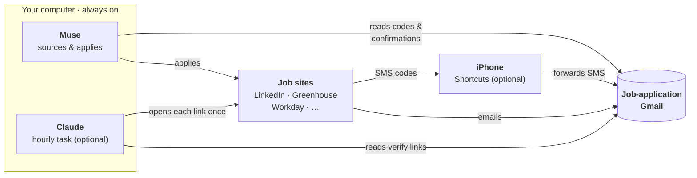

[中文](README.md) | **English**

# Muse Auto Job Apply

Let **Muse** (an AI assistant at https://muse.ai) apply to jobs for you, around the clock.

**It works for any field**, not just software: you tell Muse which job titles, levels and keywords to look for — and which keywords to filter out.

**You only need to do 2 things:**

1. **Set Muse up once**: fill in the instructions file and upload your resume.
2. **Leave it running**, and handle only the few things only you can do (clicking verification links, making calls Muse isn't sure about).

---

## The general idea (and what to watch out for)

All the details live in [muse-prompt.md](muse-prompt.md). Here is the general idea, and the points that matter most:

- **Fresh jobs first.** LinkedIn jobs are worked in a ladder — 12, then 24, then 36, then 48 hours, with 48 hours as the hard limit. Company-site jobs have no date gate and are worked newest first.
- **Lots of applications, but only real fits.** Right title, level, pay and visa situation. No random applying.
- **Apply on the company's own website.** LinkedIn is only for finding jobs, not for "Easy Apply".
- **Never lie, never guess.** If it doesn't know an answer, it asks you.
- **Never apply twice.** Everything goes into one spreadsheet that's checked first, and one job (company + role + requisition ID) never gets two applications.
- **Don't get stuck.** An application that takes over an hour is set aside, and it moves on.
- **Verification challenges mean exit.** If a site puts up a slider, a click challenge, or anything like that, the application ends on the spot: recorded, logged, tab closed. No grinding, no retrying.
- **A login wall is not a failure.** Creating an account, getting a code, or clicking a verification link are normal steps, not reasons to fail.
- **Reach a human.** It sends a short LinkedIn note to the recruiter when the posting names one.

The full version is in "How this system thinks" near the top of `muse-prompt.md`.

---

## Setup (follow these steps exactly)

**What you need:**

- Your **resume** as a PDF.
- Your **cover letter** as a PDF (optional).
- A **Gmail used only for job applications**. Making a new one is best, so job emails don't mix with your personal mail.

**Step 1: Get the instructions file**

1. Open the instructions file: **[muse-prompt.md](muse-prompt.md)**.
2. Download it: click the **download button** (the arrow ⬇ at the top right of the file).

**Step 2: Fill in the two boxes (this is the important part)**

3. Open the downloaded file:
   - **Windows:** right-click it → **Open with** → **Notepad**.
   - **Mac:** right-click it → **Open With** → **TextEdit**.
4. At the very top, under **✏️ STEP 1: FILL IN YOUR INFORMATION HERE**, there are two boxes. Replace every **`____`** with your own information. You only fill in these two boxes. You don't need to change anything else in the file:
   - **Box A: About you.** Name, email, phone, degree, years of experience, visa status, etc.
   - **Box B: What jobs to apply for.** This is where the keywords go:
     - `[TARGET_TITLES]`: the job titles you want, several of them, comma-separated. Companies name the same job differently, for example:
       ```
       [TARGET_TITLES]  = Data Analyst, Business Analyst, BI Analyst
       ```
     - `[BACKUP_TITLES]`: backup titles to use when the main ones run out, for example `Reporting Analyst, Operations Analyst`.
     - `[TARGET_LEVELS]`: seniority, for example `junior, mid-level` or `mid-level, senior`.
     - `[SKIP_KEYWORDS]`: filter-out words. Any job whose title has one of these words is ignored. For example:
       ```
       [SKIP_KEYWORDS]  = senior, staff, principal, manager, intern, internship
       ```
       - Experienced? Skip `principal, staff, director, intern, internship, new grad, graduate, lead`.
       - Student or new grad? Skip `senior, staff, principal, lead, manager`.
     - `[MAX_YEARS_REQUIRED]`: skip jobs asking for more years than this. You can set it a little above your real years (you have 3 → put 5).
     - `[MUST_HAVE_KEYWORDS]`: words a good job usually mentions, for example `Python, SQL`; or `none`.
     - `[TARGET_LOCATIONS]`: where you want to work, for example `anywhere in the US`, `remote only`, `Bay Area, Seattle`.
     - `[YOUR_COMP_FLOOR]`: the lowest yearly salary you'll apply for, for example `$130k`; or `any` if you're not sure. A floor that's too high means fewer applications.
     - `[YOUR_DO_NOT_APPLY_LIST]`: companies to never apply to, or `none`.

     Right below box B there are **ready-made examples** for software engineers, new grads, analysts, marketing, mechanical engineers and interns. Copy the one closest to you and change it.

**Step 3: Hand the file to Muse**

5. **Save** the file.
6. Go to **https://muse.ai** and sign in. Start a **new chat**.
7. Attach **3 files**: the filled-in `muse-prompt.md`, your resume PDF and your cover letter PDF.
8. **Paste this message into the chat** and send it:
   > Read muse-prompt.md. These are your rules for applying to jobs for me. My resume and cover letter are attached. Set up the scheduled job-application tasks described in Part 1, then walk me through the setup checklist in Part 6.9.
9. Muse will ask you to **connect your job Gmail** and **save your logins** for job sites. Follow what it says.

> 🔒 Never type a password into the chat. When Muse needs a password, it shows a secure form for it.

**Step 4: Leave it running**

- Muse keeps finding jobs and applying on a short cycle. You don't need to watch it.
- Only a few things need you: clicking verification links, making calls Muse isn't sure about, answering its questions. The rest runs itself.
- To stop everything: in Muse, pause its scheduled tasks.

---

## Something not working?

| What you see | What to do |
|---|---|
| Muse says it can't find a verification code | Make sure Muse is connected to your **job** Gmail. If the site texted the code, see "Forward text-message codes" below. |
| No new applications for a whole day | Muse only looks at very new jobs (LinkedIn within 48 hours, company sites newest first). Ask Muse to widen the window, e.g. "look at jobs from the last 72 hours" (Part 3.2 of `muse-prompt.md`). |

**Stop everything:** in Muse, pause its scheduled tasks.

---

## Optional extras

Not needed to get started. Add them later if you want.

<details>
<summary><b>Auto-open "verify your email" links (Claude)</b></summary>

Some job sites email you a link like "Click to verify your account". Muse can't open those links. The Claude desktop app can do it for you, every hour.

1. Open [claude-job-email-verifier.md](claude-job-email-verifier.md). Replace `<YOUR_JOB_APP_GMAIL>` with your job Gmail and `<YOUR_AGENT_NAME>` with `Muse`.
2. In the **Claude** desktop app: Settings → **Connectors** → **Gmail** → connect your job Gmail.
3. In a Claude chat, type: _"create a scheduled task that runs every hour with this prompt"_, then paste the text from section 2 of that file.
4. Turn on **Automatically approve** and **Require this computer** for the task.
5. Run it once yourself, and click **Allow** when it asks to open job sites.

Verified emails get the label `ats-verified` in Gmail.
</details>

<details>
<summary><b>Forward text-message codes to Gmail (iPhone)</b></summary>

Some sites text you a code. Muse can only read email, so your iPhone can forward those texts.

1. iPhone → **Shortcuts** app → **Automation** → **+** → **Message**.
2. **Message Contains:** `code` → choose **Run Immediately** → **Next**.
3. Add the action **Send Email**:
   - To: your job Gmail.
   - Subject: `SMS code`.
   - Body: tap it → choose **Shortcut Input → Content**.
   - Tap the arrow on the action and turn **off** **Show Compose Sheet**.
4. Repeat for other words, like `verification` or `passcode`.
5. Test: have a site text you a code and check that the email arrives.
</details>

<details>
<summary><b>What's in this repo</b></summary>

| File | What it is |
|---|---|
| [muse-prompt.md](muse-prompt.md) | Instructions for Muse: how to find jobs, apply, read codes from email, and keep records. All the details live here. |
| [claude-job-email-verifier.md](claude-job-email-verifier.md) | Instructions for the optional Claude task that opens verification links. |


</details>
