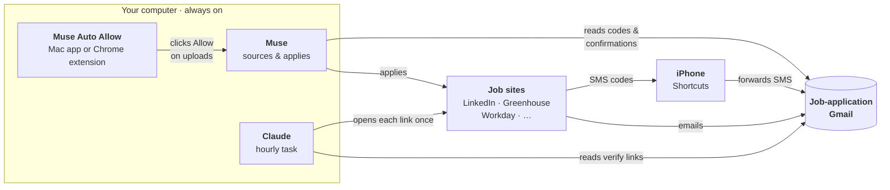

[中文](README.md) | **English**

# Muse Auto Job Apply

Leave a computer on, and it applies to jobs for you:

- **Muse** finds jobs and applies to them.
- **Muse Auto Allow** clicks **Allow** whenever Muse asks permission to upload your resume.
- **Claude** opens the "verify your email" links that job sites send.

## Contents

1. [What's in this repo](#1-whats-in-this-repo)
2. [How it works](#2-how-it-works)
3. [What you need](#3-what-you-need)
4. [Setup](#4-setup)
5. [Is it working?](#5-is-it-working)
6. [Common problems](#6-common-problems)
7. [Settings you can change](#7-settings-you-can-change)
8. [Stop everything](#8-stop-everything)

---

## 1. What's in this repo

| File / folder | What it is |
|---|---|
| [muse-auto-allow-mac/](muse-auto-allow-mac/) | **Mac app.** Build it, run it, and it clicks Allow in the Muse desktop app. |
| [muse-auto-allow-chrome/](muse-auto-allow-chrome/) | **Chrome extension** (Windows and Mac). Load it, and it clicks Allow on muse.ai. |
| [muse-prompt.md](muse-prompt.md) | **Instructions for Muse.** How to find jobs, apply, read codes from your inbox, keep records, and report. |
| [claude-job-email-verifier.md](claude-job-email-verifier.md) | **Instructions for Claude.** An hourly task that opens each job-site verification link once. |

You only need **one** of the two auto-allow tools.

## 2. How it works



1. **Muse** applies to jobs. Before uploading a file it stops and asks you to approve.
2. **Muse Auto Allow** approves for you, so Muse never sits waiting.
3. Job sites send **codes** (by email or text). Muse reads them from the inbox and types them in.
4. Job sites also send **links** ("click to verify"). Muse can't open those, so **Claude** opens them every hour.

## 3. What you need

- [ ] A **computer that stays on and plugged in**: a Mac, or a Windows PC (Chrome extension only).
- [ ] **Muse**: the desktop app (for the Mac app) or https://muse.ai in Chrome (for the extension).
- [ ] The **Claude** desktop app, with Claude in Chrome or its built-in browser.
- [ ] A **new Gmail used only for job applications**, not your personal one.
- [ ] Optional: an **iPhone**, to forward text-message codes.
- [ ] Mac app only: Xcode Command Line Tools. Run `xcode-select --install` in Terminal.

## 4. Setup

Do these in order. Each step is done once.

### Step 1: Connect the job Gmail to Muse and Claude

Muse and Claude must read the **same** job Gmail.

- **Muse:** ask Muse to connect your email, open the link it gives you, and finish. Then ask Muse to read the inbox to confirm it works. ([muse-prompt.md](muse-prompt.md) Part 6.4)
- **Claude:** Settings → Connectors → **Gmail** → connect the job Gmail. Also sign in to that Gmail in the browser Claude uses.

> Never type a password into a chat. Save website logins through Muse's secure login form ([muse-prompt.md](muse-prompt.md) Part 6.2).

### Step 2: Give Muse its instructions

1. Open [muse-prompt.md](muse-prompt.md). Replace every `[PLACEHOLDER]` with your own details. The list of placeholders is at the top of the file.
2. Give the file to Muse as its rules, and create the scheduled tasks described in Part 1.
3. Go through the checklist in Part 6.9 (save logins, connect the inbox, etc.).

### Step 3: Install the auto-allow tool (pick one)

|  | Mac app | Chrome extension |
|---|---|---|
| Works on | Mac | Windows and Mac |
| Clicks Allow in | Muse desktop app | muse.ai in Chrome |
| Setup | Build + one permission | Load a folder in Chrome |

**Mac app**, in Terminal:

```
git clone https://github.com/Dark417/muse-auto-job-apply
cd muse-auto-job-apply/muse-auto-allow-mac
./build.sh
```

1. System Settings → Privacy & Security → **Accessibility** → **+** → choose `MuseAutoAllow.app` from that folder → turn it **on**.
2. Double-click **`muse-on.command`**. You can close the Terminal window that opens.

More: [muse-auto-allow-mac/README.md](muse-auto-allow-mac/README.md)

**Chrome extension:**

1. Download this repo: `git clone` as above, or on GitHub click **Code → Download ZIP** and unzip.
2. Go to `chrome://extensions` → turn on **Developer mode** → **Load unpacked** → choose the `muse-auto-allow-chrome` folder.
3. Chrome Settings → **Performance** → **Always keep these sites active** → add `muse.ai`.

More: [muse-auto-allow-chrome/README.md](muse-auto-allow-chrome/README.md)

**Then, for either tool, leave Muse on the approvals page:**

1. Open Muse (desktop app, or muse.ai in Chrome).
2. Open the **right-hand panel**.
3. Click the **Approvals** tab (shield icon). You'll see the "Needs review" list.
4. Leave it there. The window can be behind other windows, and the Chrome tab can be in the background.

> ⚠️ **If Muse leaves this page, nothing gets clicked.** That happens if you close the panel, switch to Activity / Upcoming / Identity, quit Muse, or close the muse.ai tab.

> ⚠️ Both tools approve **every** request, not just uploads. To approve only uploads, see "Customize" in the tool's README.

### Step 4: Set up the Claude verification task

1. Open [claude-job-email-verifier.md](claude-job-email-verifier.md). Replace `<YOUR_JOB_APP_GMAIL>` and `<YOUR_AGENT_NAME>` (e.g. "Muse").
2. In the Claude desktop app, create a **scheduled task**:
   - Runs: **every hour**.
   - Prompt: copy the block from section 2 of that file, unchanged.
   - Turn on **Automatically approve** and **Require this computer**, so it can run while you're away.
   - Easier: in a Claude chat, say _"create a scheduled task that runs every hour with this prompt"_ and paste the block.
3. Run it once yourself. When the browser asks for permission on job sites, allow it.

### Step 5 (optional): Forward text-message codes to the Gmail

Some sites text you a code. Muse can only read email, so have your iPhone forward those texts.

1. iPhone → **Shortcuts** → **Automation** → **+** → **Message**.
2. **Message Contains:** `code` → choose **Run Immediately** → **Next**.
3. Add the action **Send Email**:
   - To: your job Gmail.
   - Subject: `SMS code`.
   - Body: tap it and choose **Shortcut Input → Content**.
   - Expand the action and turn **off** **Show Compose Sheet**, so it sends by itself.
4. Make one more automation for each other word sites use, like `verification` or `passcode`.
5. Test: have a site text you a code, and check that the email arrives.

Your iPhone's Mail app needs an email account that can send.

### Step 6: Keep the computer awake

**Windows:** Settings → System → **Power** → when plugged in, sleep after **Never**. Keep Chrome open. A locked screen is fine.

**Mac:** in System Settings:

| Setting | Where | Set to |
|---|---|---|
| Prevent automatic sleeping when the display is off | Battery → Options (laptop) or Energy (desktop) | **On** |
| Require password after screen saver begins or display is turned off | Lock Screen | **Never** |
| Start Screen Saver when inactive | Lock Screen | **Never** (optional) |

- Keep it plugged in. Keep the lid open, or closed with an external monitor attached.
- The screen can be off or dim. Only the computer itself has to stay awake.
- The Mac app also needs the Mac **unlocked**, so do this only somewhere you trust.
- After a restart: double-click `muse-on.command` again (Mac app), or reopen Chrome and muse.ai (extension).

## 5. Is it working?

| Part | What to look for |
|---|---|
| Mac app | `pgrep -fl MuseAutoAllow` prints one line. `muse-auto-allow-mac/muse-autoallow.log` shows `Allow pressed (ok): …` after a request. |
| Chrome extension | Click its toolbar icon: the log shows `Allow pressed: …` after a request. |
| Claude task | Each hourly run says "No new verification emails." or lists the companies it verified. Verified emails get the `ats-verified` label in Gmail. |
| Text forwarding | Texted codes appear in the job Gmail within a minute. |
| Muse | Its reports list new applications, and the "Needs review" list doesn't pile up. |

## 6. Common problems

| Problem | What to do |
|---|---|
| Requests pile up in "Needs review" | Is Muse still on the approvals page? Is the computer awake (and unlocked, for the Mac app)? Is the tool running: `pgrep` for the Mac app, or switched on with a muse.ai tab open for the extension? |
| Mac app log says `NOT TRUSTED` | In Accessibility settings, remove `MuseAutoAllow`, add it again and turn it on. Then double-click `muse-off.command` and `muse-on.command`. You need to do this after every rebuild or folder move. |
| Muse says it can't find a code | Check that text forwarding works, and that Muse reads the **job** Gmail, not your personal one. |
| A verification email never gets labeled | The page wanted a password or a form, or the site isn't on the task's allowed list. Finish it by hand, or add the site. |
| No new applications all day | Muse only looks at very recent jobs. Widen that window (see below). |

## 7. Settings you can change

- **How far back Muse looks for jobs:** [muse-prompt.md](muse-prompt.md) Part 3.2. The default is jobs from the last **12 hours**, then **24 hours** if it runs out. On a slow day Muse finds nothing and stops. To fix it, widen the window (e.g. 24 hours, then 72) and change the same numbers in Parts 7.1 and 13.1.
- **How often the auto-allow tool checks:** every 2 minutes by default. See "Customize" in the tool's README.
- **How far back the Claude task looks:** if it runs less often than hourly, raise `newer_than:4h` in its prompt.

## 8. Stop everything

- **Mac app:** double-click `muse-off.command`.
- **Chrome extension:** turn it off in its popup, or remove it at `chrome://extensions`.
- **Claude task:** pause or delete the scheduled task in Claude.
- **Muse:** pause its scheduled tasks.
- **Text forwarding:** turn off the automations in iPhone Shortcuts.
