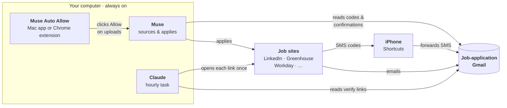

[中文](README.md) | **English**

# Muse auto job apply

A hands-off job-application pipeline that runs on a computer you leave on:
**Muse** applies to jobs, **Claude** clicks the account-verification links, and a small **Mac app** or **Chrome extension** (Windows & Mac) clicks Allow on Muse's upload prompts.

## Contents
1. [What's in this repo](#1-whats-in-this-repo)
2. [How the pieces fit](#2-how-the-pieces-fit)
3. [What you need](#3-what-you-need)
4. [Setup, in order](#4-setup-in-order)
5. [Check it's working](#5-check-its-working)
6. [Tuning](#6-tuning)
7. [Troubleshooting](#7-troubleshooting)
8. [Stop everything](#8-stop-everything)

---

## 1. What's in this repo

| File / folder | Runs in | What it does |
|---|---|---|
| [muse-auto-allow-mac/](muse-auto-allow-mac/) | **Mac** | Build it and run it; it clicks **Allow** in the Muse desktop app automatically. |
| [muse-auto-allow-chrome/](muse-auto-allow-chrome/) | **Chrome** (Windows & Mac) | Load it in Chrome; it clicks **Allow** in the Muse web app (muse.ai) automatically. |
| [muse-prompt.md](muse-prompt.md) | **Muse** | The assistant's operating manual: sources fresh jobs, applies on company sites, reads codes from your inbox, tracks everything in one log + spreadsheet, and reports. |
| [claude-job-email-verifier.md](claude-job-email-verifier.md) | **Claude** (hourly scheduled task) | Finds "verify your email / activate your account" emails from job sites in your application Gmail, opens each link once, and labels the email so it's never opened twice. |

## 2. How the pieces fit



- **Muse** does the applying. It pauses on every file upload, because Muse has no "always allow" for uploads.
- **Muse Auto Allow** (Mac app or Chrome extension) clicks Allow, so Muse never waits on you.
- **Muse** reads email and SMS verification **codes** from the inbox and types them in.
- Verification **links** can't be clicked by Muse (they arrive redacted), so the **Claude** task opens them every hour. This is the "auto-click option" in `muse-prompt.md` Part 6.7.

## 3. What you need

- A **computer that stays on**, plugged in: a **Mac** (Mac app or Chrome extension) or a **Windows PC** (Chrome extension).
- **Muse**: the desktop app (for the Mac app) or the web app at https://muse.ai in Chrome (for the extension).
- The **Claude** desktop app (for the scheduled task), plus a browser Claude can drive (Claude in Chrome or Claude's built-in browser).
- One **dedicated Gmail** used only for job applications, not your personal inbox.
- An **iPhone**, if sites text you codes (optional but recommended).
- For the Mac app only: **Xcode Command Line Tools** (`xcode-select --install`).

## 4. Setup, in order

### Step 1: Sign in to the application Gmail in both Muse and Claude

Both apps need to read the **same** application inbox:

| App | How | Why |
|---|---|---|
| Muse | Ask Muse to connect your email. It gives you a connect link; finish it and check that Muse can read the inbox. Details: `muse-prompt.md` Part 6.4. | Reads confirmations, rejections, interview invites and verification codes. |
| Claude | Settings → Connectors → Gmail, connect the application Gmail. Also sign in to that Gmail in the browser Claude will use. | The verifier searches the inbox and labels emails. |

Never paste passwords into a chat. Website logins go through Muse's secure entry form (`muse-prompt.md` Part 6.2).

### Step 2: Set up Muse

1. Open `muse-prompt.md` and replace every `[PLACEHOLDER]` (legend at the top of the file).
2. Give it to Muse as its rules, and create the scheduled job-application tasks it describes (Part 1).
3. Go through the checklist in Part 6.9: save your logins, connect the inbox, decide how uploads and links get handled.

### Step 3: Forward SMS codes to the Gmail (iPhone Shortcuts)

Some sites text a code instead of emailing it. Muse can only read email, so forward those texts:

1. On the iPhone, open **Shortcuts** → **Automation** → **+** → **Message**.
2. **Message Contains:** `code`. Choose **Run Immediately** (turn off "Notify When Run" if you like) → **Next**.
3. Add the action **Send Email**:
   - Recipient: your application Gmail.
   - Subject: `SMS code`.
   - Body: tap and pick **Shortcut Input → Content** (the message text).
   - Expand the action and turn **Show Compose Sheet** off, so it sends without asking.
4. Repeat for other words your sites use, e.g. `verification`, `passcode`. One automation per keyword.
5. Test it: ask any site to text you a code and check that the email arrives.

The iPhone's Mail app must have an account set up to send from. Muse checks the inbox for both the site's own code email and this forwarded one (Part 6.6).

### Step 4: Set up the Claude email verifier (scheduled task)

1. Open `claude-job-email-verifier.md` and replace `<YOUR_JOB_APP_GMAIL>` and `<YOUR_AGENT_NAME>` (e.g. "Muse").
2. In the Claude desktop app, create a **scheduled task**:
   - Schedule: **every hour**.
   - Prompt: the block in section 2 of that file, pasted as-is.
   - Turn on automatic approval and the option to run on this computer, so it can use your browser while you're away.
   - Shortcut: tell Claude in a chat _"create a scheduled task that runs every hour with this prompt"_ and paste the block.
3. Run it once by hand and accept the browser permission prompts for the job-site domains.

### Step 5: Install the auto-approve tool

Pick **one**. They do the same thing: click Allow on Muse's "Needs review" prompts every 2 minutes.

| | Option A: Mac app | Option B: Chrome extension |
|---|---|---|
| Works on | Mac | Windows and Mac |
| Clicks in | Muse desktop app | Muse web app (muse.ai) in Chrome |
| Setup | Build + Accessibility permission | Load the folder in Chrome |

**Option A: Mac app.**

```
git clone https://github.com/Dark417/muse-auto-job-apply
cd muse-auto-job-apply/muse-auto-allow-mac
./build.sh
```

1. System Settings → Privacy & Security → **Accessibility** → **+** → choose `muse-auto-allow-mac/MuseAutoAllow.app` → switch it **on**.
2. Open the Muse desktop app on the approvals page (see the note below).
3. Double-click **`muse-on.command`**. It starts in the background, so you can close the Terminal window. `muse-off.command` stops it.

Full details: [muse-auto-allow-mac/README.md](muse-auto-allow-mac/README.md).

**Option B: Chrome extension (Windows & Mac).**

1. Get the repo (`git clone` as above, or **Code → Download ZIP** on GitHub).
2. Chrome → `chrome://extensions` → turn on **Developer mode** → **Load unpacked** → choose the `muse-auto-allow-chrome` folder.
3. Open https://muse.ai, sign in, go to the approvals page (see the note below), and leave the tab open.
4. Chrome → Settings → Performance → **Always keep these sites active** → add `muse.ai`, so Chrome doesn't put the tab to sleep.

Full details: [muse-auto-allow-chrome/README.md](muse-auto-allow-chrome/README.md).

> **Muse must stay on this page, or nothing gets clicked:** right panel open → the **Approvals (shield icon)** tab selected, showing the "Needs review" list.
> - If the panel is closed, another tab is selected (Activity / Upcoming / Identity), Muse is quit (Mac app), or the muse.ai tab is closed (Chrome extension), **nothing is clicked**.
> - Once it's on that page you can leave it: the Muse window can sit behind other windows, and the muse.ai tab can be in the background.

> Both tools click Allow on **every** Muse prompt, including sensitive-site access. Each README shows how to limit it to uploads.

### Step 6: Keep the computer awake forever

**On Windows (Chrome extension):** Settings → System → Power → set sleep when plugged in to **Never**, and keep Chrome open. A locked screen is fine for the extension.

**On a Mac:** the Mac app can't click on a sleeping or locked Mac (the Chrome extension only needs it awake). In System Settings:

| Setting | Where | Value |
|---|---|---|
| Don't sleep | Battery → Options (laptop) or Energy (desktop) | **Prevent automatic sleeping when the display is off**: on |
| Don't lock | Lock Screen | **Require password after screen saver begins or display is turned off**: Never |
| Screen saver | Lock Screen | **Start Screen Saver when inactive**: Never (optional) |

- Keep it **plugged in** with the lid **open** (or closed with an external monitor and power).
- The display can turn off or be dimmed; only the system has to stay awake.
- This leaves your Mac unlocked, so only do it somewhere you trust.
- After a reboot, double-click `muse-on.command` again (Mac app), or reopen Chrome and the muse.ai tab (extension).

## 5. Check it's working

| Piece | How to check |
|---|---|
| Mac app | `pgrep -fl MuseAutoAllow` shows one line. `tail muse-auto-allow-mac/muse-autoallow.log` shows `Allow pressed (ok): …` after an upload prompt. |
| Chrome extension | Click its icon: the log shows `Allow pressed: …` after an upload prompt. The badge shows how many it allowed in the last pass. |
| Claude verifier | Its hourly runs say "No new verification emails." or list verified companies. Verified emails get the `ats-verified` label in Gmail. |
| SMS forwarding | Texted codes show up in the application Gmail within a minute. |
| Muse | Its reports show new applications; upload prompts don't pile up in the approvals list. |

## 6. Tuning

- **Sourcing window (`muse-prompt.md` Part 3.2):** the default is jobs posted in the last **12 hours**, falling back to **24 hours**. On a slow day, or once you've applied to everything fresh, Muse finds **nothing new and stops applying**. If your reports show zero new work, widen it (e.g. 24h primary, 72h fallback) and update the matching lines in Part 7.1 and Part 13.1.
- **Auto-approve timing:** `interval` (default 2 min) at the top of `MuseAutoAllow.swift`. Rebuild and re-grant Accessibility after changing it.
- **Verifier lookback:** if you run the Claude task less often than hourly, raise `newer_than:4h` in its prompt.

## 7. Troubleshooting

| Symptom | Fix |
|---|---|
| Log says `NOT TRUSTED` | Remove `MuseAutoAllow` from Accessibility, add it again, switch it on, then `muse-off.command` and `muse-on.command`. This is needed after every rebuild or folder move. |
| Upload prompts pile up | Is the computer asleep (or locked, for the Mac app)? Is the app running (`pgrep`), or the extension switched on with a muse.ai tab open? Is Muse on the approvals page (panel open, Approvals tab)? |
| Muse says a code is missing | Check that SMS forwarding works and that Muse is reading the **application** inbox, not a personal one. |
| Verification emails stay unlabeled | The page asked for a password or form ("needs user"), or the domain isn't on the allow-list. Finish it by hand, or add the domain. |
| No new applications for a day | Sourcing window too narrow; see Tuning. |

## 8. Stop everything

- **Mac app:** double-click `muse-off.command`, or run `pkill -f MuseAutoAllow.app`.
- **Chrome extension:** switch it off in its popup, or remove it on `chrome://extensions`.
- **Claude verifier:** pause or delete the scheduled task in Claude.
- **Muse:** pause its scheduled tasks in the app.
- **SMS forwarding:** turn off the automations in iPhone Shortcuts.
