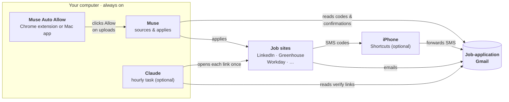

[中文](README.md) | **English**

# Muse Auto Job Apply

Let **Muse** (an AI assistant at https://muse.ai) apply to jobs for you, around the clock.

**It works for any field**, not just software: you tell Muse which job titles, levels and keywords to look for.

You only need to do **3 things**:

1. **Set up Muse** with the instructions file, your information, your resume and cover letter.
2. When Muse starts asking you to click **Allow**, **install the Chrome extension** from this page.
3. **Turn the extension on** and leave Muse open. That's it.

---

## Step 1: Set up Muse to apply for you

**What you need:**
- Your **resume** as a PDF.
- Your **cover letter** as a PDF (optional).
- A **Gmail used only for job applications**. Making a new one is best, so job emails don't mix with your personal mail.

**Do this:**

1. Open the instructions file: **[muse-prompt.md](muse-prompt.md)**.
2. Download it: click the **download button** (the arrow ⬇ at the top right of the file).
3. Open the downloaded file:
   - **Windows:** right-click it → **Open with** → **Notepad**.
   - **Mac:** right-click it → **Open With** → **TextEdit**.
4. At the very top, under **✏️ STEP 1: FILL IN YOUR INFORMATION HERE**, there are two boxes. Replace every **`____`** with your own information:
   - **Box A: About you.** Name, email, phone, degree, years of experience, visa status, etc.
   - **Box B: What jobs to apply for.** The job titles you want, backup titles, your level, and **skip words**: any job whose title has one of these words is ignored. For example:
     ```
     [TARGET_TITLES]  = Data Analyst, Business Analyst, BI Analyst
     [BACKUP_TITLES]  = Reporting Analyst, Operations Analyst
     [TARGET_LEVELS]  = junior, mid-level
     [SKIP_KEYWORDS]  = senior, staff, principal, manager, intern, internship
     ```
     - Experienced? Skip `principal, staff, director, intern, internship, new grad`.
     - Student or new grad? Skip `senior, staff, principal, lead, manager`.

     Right below box B there are **ready-made examples** for software engineers, new grads, analysts, marketing, mechanical engineers and interns. Copy the one closest to you and change it.

   You only fill in these two boxes. You don't need to change anything else in the file.
5. **Save** the file.
6. Go to **https://muse.ai** and sign in. Start a **new chat**.
7. Attach **3 files**: the filled-in `muse-prompt.md`, your resume PDF and your cover letter PDF.
8. Paste this message and send it:
   > Read muse-prompt.md. These are your rules for applying to jobs for me. My resume and cover letter are attached. Set up the scheduled job-application tasks described in Part 1, then walk me through the setup checklist in Part 6.9.
9. Muse will ask you to **connect your job Gmail** and **save your logins** for job sites. Follow what it says.

> 🔒 Never type a password into the chat. When Muse needs a password, it shows a secure form for it.

### How Muse goes about it

`muse-prompt.md` is the author's own playbook. In short:

- **Fresh jobs first.** It applies within hours of a job being posted, when recruiters are still reading applications.
- **Lots of applications, but only real fits.** Right title, level, pay and visa situation. No random applying.
- **Apply on the company's own website.** LinkedIn is only for finding jobs, not for "Easy Apply".
- **Never lie, never guess.** If it doesn't know an answer, it asks you.
- **Never apply twice.** Everything goes into one spreadsheet that's checked first.
- **Don't get stuck.** An application that takes over an hour is set aside, and it moves on.
- **Reach a human.** It sends a short LinkedIn note to the recruiter when the posting names one.

The full version is in "How this system thinks" near the top of `muse-prompt.md`.

---

## Step 2: When "Allow" buttons appear, install the Chrome extension

Once Muse starts applying, it **stops before every resume upload** and waits for you to click a blue **Allow** or **Allow once** button. You'll see them here:

**muse.ai → right-hand panel → Approvals tab (🛡 shield icon) → "Needs review"**

Instead of clicking them yourself all day, install this extension. It clicks them for you.

**Install it (one time, about 2 minutes):**

1. On this GitHub page, click the green **Code** button → **Download ZIP**.
2. Unzip it:
   - **Windows:** right-click the ZIP → **Extract All** → **Extract**.
   - **Mac:** double-click the ZIP.

   You now have a folder called **`muse-auto-job-apply-main`**.
3. Open **Google Chrome**. In the address bar at the top, type **`chrome://extensions`** and press **Enter**.
4. At the top right, turn on **Developer mode**.
5. Click **Load unpacked** (top left).
6. Open the `muse-auto-job-apply-main` folder, click the **`muse-auto-allow-chrome`** folder inside it **once**, then click **Select** (or **Open**).
7. **Muse Auto Allow** now appears in the list of extensions. ✅

> Don't delete or move the unzipped folder afterwards. Chrome runs the extension from it.

---

## Step 3: Turn it on and leave Muse open

1. **Pin the extension:** click the **puzzle piece 🧩** at the top right of Chrome → click the **pin 📌** next to **Muse Auto Allow**. Its icon now shows in the toolbar.
2. **Turn it on:** click the **Muse Auto Allow** icon → make sure **Enabled** is **checked** ☑.
3. **Put Muse on the right page:** in your **muse.ai** tab, open the **right-hand panel** and click the **Approvals** tab (🛡 shield). You should see **"Needs review"**.
4. **Test it:** click the extension icon → **Run now**. Any waiting requests get approved, and the list below shows lines like `Allow pressed: …`.
5. **Leave it.** From now on it checks every 2 minutes, by itself.

**How it clicks:**
- Blue button says **Allow** → it clicks Allow.
- Blue button says **Allow once** → it opens the small arrow ⌄ menu next to it and clicks **Always allow**, so that website doesn't ask again.

**To keep it working:**

- ⚠️ **Keep the muse.ai tab on the Approvals page.** If you close the panel, switch to another tab in the panel (Activity, Upcoming, Identity), or close the muse.ai tab, nothing gets clicked. Other Chrome tabs and windows are fine.
- **Keep Chrome open.** It can be minimized.
- **Stop Chrome from putting the tab to sleep:** type `chrome://settings/performance` in the address bar → **Always keep these sites active** → **Add** → type `muse.ai` → **Add**.
- **Stop the computer from sleeping:**
  - **Windows:** Start → Settings → System → **Power** → "When plugged in, put my device to sleep after" → **Never**.
  - **Mac:** System Settings → **Battery** → Options (laptop) or **Energy** (desktop) → turn on **Prevent automatic sleeping when the display is off**. Keep it plugged in.

  The screen can go dark or lock. Only the computer must stay awake.

**That's it.** 🎉

---

## Something not working?

| What you see | What to do |
|---|---|
| Requests pile up in "Needs review" | Is the muse.ai tab still on the **Approvals** tab? Is **Enabled** checked? Is the computer awake? |
| The extension list says `No muse.ai tab open` | Open https://muse.ai in Chrome and keep that tab open. |
| The extension list says `sections 0` | The muse.ai tab isn't on the Approvals page. Open the right-hand panel → Approvals, then click **Run now**. |
| Muse says it can't find a verification code | Make sure Muse is connected to your **job** Gmail. If the site texted the code, see "Forward text-message codes" below. |
| No new applications for a whole day | Muse only looks at very new jobs (last 12–24 hours). Ask Muse to widen the window, e.g. "look at jobs from the last 72 hours" (Part 3.2 of `muse-prompt.md`). |
| After restarting the computer | Open Chrome, open muse.ai, and go back to the Approvals page. |

**Stop everything:** in Muse, pause its scheduled tasks. In Chrome, click the extension icon and uncheck **Enabled**.

---

## Optional extras

Not needed to get started. Add them later if you want.

<details>
<summary><b>Auto-open "verify your email" links (Claude)</b></summary>

Some job sites email you a link like "Click to verify your account". Muse can't open those links. The Claude desktop app can do it for you, every hour.

1. Open [claude-job-email-verifier.md](claude-job-email-verifier.md). Replace `<YOUR_JOB_APP_GMAIL>` with your job Gmail and `<YOUR_AGENT_NAME>` with `Muse`.
2. In the **Claude** desktop app: Settings → **Connectors** → **Gmail** → connect your job Gmail.
3. In a Claude chat, type: _"create a scheduled task that runs every hour with this prompt"_, then paste the text from section 2 of that file.
4. Turn on **Automatically approve** and **Require this computer** for the task.
5. Run it once yourself, and click **Allow** when it asks to open job sites.

Verified emails get the label `ats-verified` in Gmail.
</details>

<details>
<summary><b>Forward text-message codes to Gmail (iPhone)</b></summary>

Some sites text you a code. Muse can only read email, so your iPhone can forward those texts.

1. iPhone → **Shortcuts** app → **Automation** → **+** → **Message**.
2. **Message Contains:** `code` → choose **Run Immediately** → **Next**.
3. Add the action **Send Email**:
   - To: your job Gmail.
   - Subject: `SMS code`.
   - Body: tap it → choose **Shortcut Input → Content**.
   - Tap the arrow on the action and turn **off** **Show Compose Sheet**.
4. Repeat for other words, like `verification` or `passcode`.
5. Test: have a site text you a code and check that the email arrives.
</details>

<details>
<summary><b>Use the Muse desktop app on a Mac instead of Chrome</b></summary>

If you use the Muse **desktop app** on a Mac instead of muse.ai in Chrome, use the Mac app in [muse-auto-allow-mac/](muse-auto-allow-mac/). It needs Terminal and a one-time permission. Follow its [README](muse-auto-allow-mac/README.md).
</details>

<details>
<summary><b>What's in this repo</b></summary>

| File / folder | What it is |
|---|---|
| [muse-prompt.md](muse-prompt.md) | Instructions for Muse: how to find jobs, apply, read codes from email, and keep records. |
| [muse-auto-allow-chrome/](muse-auto-allow-chrome/) | The Chrome extension (Windows and Mac). [More details](muse-auto-allow-chrome/README.md). |
| [muse-auto-allow-mac/](muse-auto-allow-mac/) | The same thing as a Mac app, for the Muse desktop app. |
| [claude-job-email-verifier.md](claude-job-email-verifier.md) | Instructions for the optional Claude task that opens verification links. |


</details>
