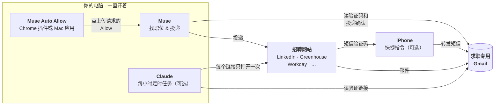

**中文** | [English](README.en.md)

# Muse 自动投简历

让 **Muse**（https://muse.ai 上的 AI 助手）24 小时帮你投简历。

你只需要做 **3 件事**：

1. **设置 Muse**：给它说明书文件、你的个人信息、简历和求职信。
2. 等 Muse 开始请你点 **Allow** 的时候，**安装这个页面上的 Chrome 插件**。
3. **打开插件**，让 Muse 一直开着。就这样。

---

## 第 1 步：设置 Muse 帮你投简历

**准备好：**
- **简历** PDF。
- **求职信（cover letter）** PDF（可选）。
- 一个**只用来求职的 Gmail**。最好新建一个，这样求职邮件不会和私人邮件混在一起。

**照着做：**

1. 打开说明书文件：**[muse-prompt.md](muse-prompt.md)**。
2. 下载它：点文件右上角的**下载按钮**（向下的箭头 ⬇）。
3. 打开下载好的文件：
   - **Windows：** 右键 → **打开方式** → **记事本**。
   - **Mac：** 右键 → **打开方式** → **文本编辑**。
4. 在文件最上面找到 **✏️ STEP 1: FILL IN YOUR INFORMATION HERE** 这个框。
   把每一个 **`____`** 换成你自己的信息。每一行后面都有例子，比如：
   ```
   [YOUR_NAME]               = Jane Doe
   [YOUR_CITY_STATE]         = Seattle, WA
   ```
   只需要填这个框，文件里别的地方都不用改。
5. **保存**文件。
6. 打开 **https://muse.ai** 并登录，开一个**新对话**。
7. 上传 **3 个文件**：填好的 `muse-prompt.md`、简历 PDF、求职信 PDF。
8. 复制下面这段话发给 Muse：
   > Read muse-prompt.md. These are your rules for applying to jobs for me. My resume and cover letter are attached. Set up the scheduled job-application tasks described in Part 1, then walk me through the setup checklist in Part 6.9.
9. Muse 会请你**连接求职 Gmail**、**保存各个招聘网站的登录信息**。按它说的做就行。

> 🔒 不要在聊天里输入密码。需要密码时，Muse 会弹出一个安全的输入框。

---

## 第 2 步：出现 "Allow" 按钮时，安装 Chrome 插件

Muse 开始投简历以后，**每次上传简历前都会停下来**，等你点一个蓝色的 **Allow** 或 **Allow once** 按钮。这些按钮在这里：

**muse.ai → 右侧面板 → Approvals 标签（🛡 盾牌图标）→ "Needs review"**

不用一整天守着点，装上这个插件，它会帮你点。

**安装（只需一次，大约 2 分钟）：**

1. 在这个 GitHub 页面上，点绿色的 **Code** 按钮 → **Download ZIP**。
2. 解压：
   - **Windows：** 右键 ZIP 文件 → **全部解压缩** → **解压缩**。
   - **Mac：** 双击 ZIP 文件。

   你会得到一个叫 **`muse-auto-job-apply-main`** 的文件夹。
3. 打开 **Google Chrome**，在最上面的地址栏输入 **`chrome://extensions`**，按**回车**。
4. 打开右上角的**开发者模式**开关。
5. 点左上角的**加载已解压的扩展程序**。
6. 打开 `muse-auto-job-apply-main` 文件夹，**单击一下**里面的 **`muse-auto-allow-chrome`** 文件夹，再点**选择**（或**打开**）。
7. 扩展列表里出现 **Muse Auto Allow**，就装好了。✅

> 解压出来的文件夹之后不要删、也不要移动，Chrome 要从这个文件夹运行插件。

---

## 第 3 步：打开插件，让 Muse 一直开着

1. **固定插件：** 点 Chrome 右上角的**拼图图标 🧩** → 点 **Muse Auto Allow** 旁边的**图钉 📌**。插件图标就会出现在工具栏上。
2. **打开插件：** 点 **Muse Auto Allow** 图标 → 确认 **Enabled** 是**勾上**的 ☑。
3. **让 Muse 停在对的页面：** 在 **muse.ai** 标签页里，打开**右侧面板**，点 **Approvals** 标签（🛡 盾牌），能看到 **"Needs review"**。
4. **测试一下：** 点插件图标 → **Run now**。正在等待的请求会被批准，下面的日志里会出现 `Allow pressed: …`。
5. **放着不管。** 之后它每 2 分钟自动检查一次。

**它怎么点：**
- 蓝色按钮写 **Allow** → 直接点 Allow。
- 蓝色按钮写 **Allow once** → 打开旁边的小箭头 ⌄ 菜单，点 **Always allow**（永远允许），这个网站以后就不会再问了。

**让它一直有效：**

- ⚠️ **muse.ai 标签页必须一直停在 Approvals 页面。** 关掉右侧面板、切到面板里的其他标签（Activity、Upcoming、Identity），或者关掉 muse.ai 标签页，都会让它什么都点不到。打开别的 Chrome 标签页或窗口没关系。
- **Chrome 要一直开着**，可以最小化。
- **别让 Chrome 让这个标签页休眠：** 在地址栏输入 `chrome://settings/performance` → **始终让这些网站保持活动状态** → **添加** → 输入 `muse.ai` → **添加**。
- **别让电脑睡眠：**
  - **Windows：** 开始 → 设置 → 系统 → **电源** → "插入电源时，在此时间后使设备进入睡眠状态" → **从不**。
  - **Mac：** 系统设置 → **电池** → 选项（笔记本）或 **节能**（台式机）→ 打开**显示器关闭时防止自动进入睡眠**。一直插着电。

  屏幕可以黑屏、可以锁屏，只要电脑本身不睡眠就行。

**就这样！** 🎉

---

## 遇到问题？

| 你看到的 | 怎么办 |
|---|---|
| "Needs review" 里的请求越积越多 | muse.ai 标签页还停在 **Approvals** 吗？**Enabled** 勾上了吗？电脑睡着了吗？ |
| 插件日志写 `No muse.ai tab open` | 在 Chrome 里打开 https://muse.ai，标签页不要关。 |
| 插件日志写 `sections 0` | muse.ai 标签页没停在 Approvals 页面。打开右侧面板 → Approvals，再点 **Run now**。 |
| Muse 说找不到验证码 | 确认 Muse 连的是你的**求职** Gmail。如果网站是发短信，看下面的"把短信验证码转发到 Gmail"。 |
| 一整天都没有新投递 | Muse 只找最新的职位（最近 12–24 小时）。跟 Muse 说放宽范围，比如 "look at jobs from the last 72 hours"（`muse-prompt.md` 第 3.2 节）。 |
| 电脑重启以后 | 打开 Chrome，打开 muse.ai，回到 Approvals 页面。 |

**全部停止：** 在 Muse 里暂停它的定时任务；在 Chrome 里点插件图标，取消勾选 **Enabled**。

---

## 可选的额外功能

刚开始用不到，以后需要再加。

<details>
<summary><b>自动打开"验证邮箱"链接（Claude）</b></summary>

有些招聘网站会发一封带链接的邮件，比如"点击验证你的账号"。Muse 打不开这种链接，Claude 桌面应用可以每小时帮你打开。

1. 打开 [claude-job-email-verifier.md](claude-job-email-verifier.md)，把 `<YOUR_JOB_APP_GMAIL>` 换成你的求职 Gmail，把 `<YOUR_AGENT_NAME>` 换成 `Muse`。
2. 在 **Claude** 桌面应用里：设置 → **Connectors** → **Gmail** → 连接求职 Gmail。
3. 在 Claude 聊天里输入：_"create a scheduled task that runs every hour with this prompt"_，再把那个文件第 2 节的内容粘贴进去。
4. 给这个任务打开 **Automatically approve** 和 **Require this computer**。
5. 自己先手动跑一次，它要打开招聘网站时点 **Allow**。

验证过的邮件在 Gmail 里会带 `ats-verified` 标签。
</details>

<details>
<summary><b>把短信验证码转发到 Gmail（iPhone）</b></summary>

有些网站用短信发验证码。Muse 只能读邮件，所以让 iPhone 把这些短信转成邮件。

1. iPhone → **快捷指令** App → **自动化** → **+** → **信息**。
2. **信息包含**：`code` → 选**立即运行** → **下一步**。
3. 添加操作**发送电子邮件**：
   - 收件人：你的求职 Gmail。
   - 主题：`SMS code`。
   - 正文：点一下 → 选 **快捷指令输入 → 内容**。
   - 点这个操作上的小箭头，**关掉**"显示撰写表单"。
4. 对其他关键词（比如 `verification`、`验证码`）各做一个。
5. 测试：让一个网站给你发短信验证码，看邮件有没有到。
</details>

<details>
<summary><b>在 Mac 上用 Muse 桌面应用（不用 Chrome）</b></summary>

如果你在 Mac 上用的是 Muse **桌面应用**，不是 Chrome 里的 muse.ai，就用 [muse-auto-allow-mac/](muse-auto-allow-mac/) 里的 Mac 应用。它需要用终端，并给一次权限。按它的 [README](muse-auto-allow-mac/README.md) 做。
</details>

<details>
<summary><b>仓库里有什么</b></summary>

| 文件 / 文件夹 | 是什么 |
|---|---|
| [muse-prompt.md](muse-prompt.md) | 给 Muse 的说明书：怎么找职位、投递、从邮箱读验证码、做记录。 |
| [muse-auto-allow-chrome/](muse-auto-allow-chrome/) | Chrome 插件（Windows 和 Mac）。[详细说明](muse-auto-allow-chrome/README.md)。 |
| [muse-auto-allow-mac/](muse-auto-allow-mac/) | 同样功能的 Mac 应用，配 Muse 桌面应用用。 |
| [claude-job-email-verifier.md](claude-job-email-verifier.md) | 可选的 Claude 任务说明，用来打开验证链接。 |


</details>
