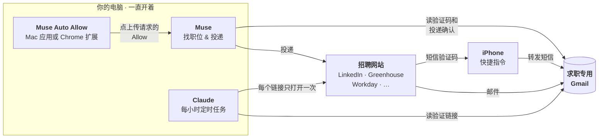

**中文** | [English](README.en.md)

# Muse 自动投简历

让一台电脑一直开着，它就会帮你投简历：

- **Muse** 找职位、投简历。
- **Muse Auto Allow** 在 Muse 请求上传简历时，自动帮你点 **Allow**。
- **Claude** 自动打开招聘网站发来的"验证邮箱"链接。

## 目录

1. [仓库里有什么](#1-仓库里有什么)
2. [怎么运作](#2-怎么运作)
3. [需要准备什么](#3-需要准备什么)
4. [设置步骤](#4-设置步骤)
5. [怎么确认在正常运行](#5-怎么确认在正常运行)
6. [常见问题](#6-常见问题)
7. [可以调的设置](#7-可以调的设置)
8. [全部停止](#8-全部停止)

---

## 1. 仓库里有什么

| 文件 / 文件夹 | 是什么 |
|---|---|
| [muse-auto-allow-mac/](muse-auto-allow-mac/) | **Mac 应用。** 编译、运行，它就会自动在 Muse 桌面应用里点 Allow。 |
| [muse-auto-allow-chrome/](muse-auto-allow-chrome/) | **Chrome 扩展**（Windows 和 Mac 都能用）。加载到 Chrome，它就会自动在 muse.ai 里点 Allow。 |
| [muse-prompt.md](muse-prompt.md) | **给 Muse 的说明书。** 怎么找职位、投递、从邮箱读验证码、做记录和汇报。 |
| [claude-job-email-verifier.md](claude-job-email-verifier.md) | **给 Claude 的说明书。** 一个每小时运行的定时任务，把每个验证链接打开一次。 |

两个自动点 Allow 的工具，**只需要装一个**。

## 2. 怎么运作



1. **Muse** 投简历。每次要上传文件前，它会停下来等你批准。
2. **Muse Auto Allow** 替你批准，Muse 就不会卡住等你。
3. 招聘网站会发**验证码**（邮件或短信）。Muse 从邮箱里读出来，自己填上。
4. 招聘网站还会发**验证链接**（"点击验证"）。Muse 打不开这种链接，所以由 **Claude** 每小时去打开。

## 3. 需要准备什么

- [ ] 一台**一直开着、插着电**的电脑：Mac，或者 Windows 电脑（只能用 Chrome 扩展）。
- [ ] **Muse**：桌面应用（配 Mac 应用用），或者 Chrome 里的 https://muse.ai（配扩展用）。
- [ ] **Claude** 桌面应用，以及 Claude in Chrome 或 Claude 自带的浏览器。
- [ ] 一个**新的、只用来求职的 Gmail**，不要用私人邮箱。
- [ ] 可选：一部 **iPhone**，用来转发短信验证码。
- [ ] 只有 Mac 应用需要：Xcode 命令行工具。在终端里运行 `xcode-select --install`。

## 4. 设置步骤

按顺序做，每一步只需要做一次。

### 第 1 步：把求职 Gmail 连到 Muse 和 Claude

Muse 和 Claude 要读的是**同一个**求职 Gmail。

- **Muse：** 让 Muse 连接你的邮箱，打开它给你的链接，完成连接。然后让 Muse 读一下邮箱，确认能用。（[muse-prompt.md](muse-prompt.md) 第 6.4 节）
- **Claude：** 设置 → Connectors → **Gmail** → 连接求职 Gmail。另外在 Claude 用的浏览器里也登录这个 Gmail。

> 不要在聊天里输入密码。网站登录信息通过 Muse 的安全登录表单保存（[muse-prompt.md](muse-prompt.md) 第 6.2 节）。

### 第 2 步：把说明书交给 Muse

1. 打开 [muse-prompt.md](muse-prompt.md)，把所有 `[PLACEHOLDER]` 换成你自己的信息。要替换的内容列在文件开头。
2. 把这个文件交给 Muse 作为规则，并按第 1 部分创建定时任务。
3. 按第 6.9 节的清单走一遍（保存各网站登录、连接邮箱等）。

### 第 3 步：安装自动点 Allow 的工具（二选一）

|  | Mac 应用 | Chrome 扩展 |
|---|---|---|
| 能用在 | Mac | Windows 和 Mac |
| 在哪里点 Allow | Muse 桌面应用 | Chrome 里的 muse.ai |
| 安装 | 编译 + 给一次权限 | 在 Chrome 里加载一个文件夹 |

**Mac 应用**，在终端里运行：

```
git clone https://github.com/Dark417/muse-auto-job-apply
cd muse-auto-job-apply/muse-auto-allow-mac
./build.sh
```

1. 系统设置 → 隐私与安全性 → **辅助功能** → **+** → 选这个文件夹里的 `MuseAutoAllow.app` → **打开开关**。
2. 双击 **`muse-on.command`**。弹出的终端窗口可以直接关掉。

详细说明：[muse-auto-allow-mac/README.md](muse-auto-allow-mac/README.md)

**Chrome 扩展：**

1. 下载这个仓库：用上面的 `git clone`，或者在 GitHub 上点 **Code → Download ZIP** 再解压。
2. 打开 `chrome://extensions` → 打开**开发者模式** → **加载已解压的扩展程序** → 选 `muse-auto-allow-chrome` 文件夹。
3. Chrome 设置 → **性能** → **始终让这些网站保持活动状态** → 添加 `muse.ai`。

详细说明：[muse-auto-allow-chrome/README.md](muse-auto-allow-chrome/README.md)

**装好以后，不管用哪个工具，都要让 Muse 停在审批页：**

1. 打开 Muse（桌面应用，或 Chrome 里的 muse.ai）。
2. 打开**右侧面板**。
3. 点 **Approvals** 标签（盾牌图标），会看到 "Needs review" 列表。
4. 就停在这里。窗口可以被别的窗口挡住，Chrome 标签页也可以放在后台。

> ⚠️ **Muse 一离开这个页面，就不会点了。** 比如：关掉面板、切到 Activity / Upcoming / Identity、退出 Muse、或者关掉 muse.ai 标签页。

> ⚠️ 两个工具都会批准**所有**请求，不只是上传。如果只想批准上传，看对应工具 README 里的"自定义"。

### 第 4 步：设置 Claude 验证任务

1. 打开 [claude-job-email-verifier.md](claude-job-email-verifier.md)，替换 `<YOUR_JOB_APP_GMAIL>` 和 `<YOUR_AGENT_NAME>`（比如填 "Muse"）。
2. 在 Claude 桌面应用里创建一个**定时任务（scheduled task）**：
   - 频率：**每小时**。
   - Prompt：把那个文件第 2 节里的内容原样复制进去。
   - 打开 **Automatically approve** 和 **Require this computer**，这样你不在的时候它也能跑。
   - 更简单的办法：在 Claude 聊天里说 _"create a scheduled task that runs every hour with this prompt"_，再粘贴那段内容。
3. 自己先手动跑一次。浏览器请求访问招聘网站时，点允许。

### 第 5 步（可选）：把短信验证码转发到 Gmail

有些网站用短信发验证码。Muse 只能读邮件，所以让 iPhone 把这些短信转成邮件。

1. iPhone → **快捷指令** → **自动化** → **+** → **信息**。
2. **信息包含**：`code` → 选**立即运行** → **下一步**。
3. 添加操作**发送电子邮件**：
   - 收件人：你的求职 Gmail。
   - 主题：`SMS code`。
   - 正文：点一下，选 **快捷指令输入 → 内容**。
   - 展开这个操作，**关掉**"显示撰写表单"，这样会自动发出。
4. 网站常用的其他词（比如 `verification`、`验证码`）各建一个自动化。
5. 测试：让一个网站给你发短信验证码，看邮件有没有到。

iPhone 自带的"邮件"App 里要有一个能发信的账户。

### 第 6 步：让电脑一直醒着

**Windows：** 设置 → 系统 → **电源** → 插电时睡眠设为**从不**。Chrome 保持打开。锁屏没关系。

**Mac：** 在系统设置里：

| 设置 | 位置 | 设为 |
|---|---|---|
| 显示器关闭时防止自动进入睡眠 | 电池 → 选项（笔记本）或 节能（台式机） | **打开** |
| 屏幕保护程序启动或显示器关闭后需要密码 | 锁定屏幕 | **永不** |
| 不活跃时启动屏幕保护程序 | 锁定屏幕 | **永不**（可选） |

- 一直插着电。盖子打开，或者合盖但接着外接显示器。
- 屏幕可以关掉或调暗，只要电脑本身醒着就行。
- Mac 应用还要求电脑**不锁屏**，所以只在你放心的地方这么做。
- 重启以后：再双击一次 `muse-on.command`（Mac 应用），或者重新打开 Chrome 和 muse.ai（扩展）。

## 5. 怎么确认在正常运行

| 部分 | 看什么 |
|---|---|
| Mac 应用 | `pgrep -fl MuseAutoAllow` 显示一行。有请求之后，`muse-auto-allow-mac/muse-autoallow.log` 里出现 `Allow pressed (ok): …`。 |
| Chrome 扩展 | 点工具栏上的扩展图标，有请求之后日志里出现 `Allow pressed: …`。 |
| Claude 任务 | 每小时的结果写着 "No new verification emails."，或者列出验证成功的公司。验证过的邮件在 Gmail 里带 `ats-verified` 标签。 |
| 短信转发 | 短信验证码一分钟内出现在求职 Gmail 里。 |
| Muse | 汇报里有新的投递，"Needs review" 列表不会越积越多。 |

## 6. 常见问题

| 问题 | 怎么办 |
|---|---|
| "Needs review" 里的请求越积越多 | Muse 还停在审批页吗？电脑醒着吗（Mac 应用还要求不锁屏）？工具在运行吗：Mac 应用用 `pgrep` 查；扩展要是打开状态，并且有 muse.ai 标签页开着。 |
| Mac 应用日志写 `NOT TRUSTED` | 在辅助功能里删掉 `MuseAutoAllow`，重新添加并打开开关。然后双击 `muse-off.command`，再双击 `muse-on.command`。每次重新编译或移动文件夹后都要做一次。 |
| Muse 说找不到验证码 | 检查短信转发是否正常，以及 Muse 读的是**求职** Gmail，不是私人邮箱。 |
| 验证邮件一直没被打标签 | 页面要求输密码或填表，或者这个网站不在任务的允许列表里。手动处理，或者把网站加进去。 |
| 一整天没有新投递 | Muse 只找最近发布的职位，范围太窄了。见下面"可以调的设置"。 |

## 7. 可以调的设置

- **Muse 找多新的职位：** [muse-prompt.md](muse-prompt.md) 第 3.2 节。默认只找最近 **12 小时**的，找完了再放宽到 **24 小时**。新职位少的时候，Muse 会找不到工作然后停下来。解决办法是放宽范围（比如先 24 小时，再 72 小时），并把第 7.1 节和第 13.1 节里对应的数字一起改掉。
- **自动点 Allow 的频率：** 默认每 2 分钟。见对应工具 README 里的"自定义"。
- **Claude 任务往回看多久：** 如果不是每小时跑一次，就把 prompt 里的 `newer_than:4h` 调大。

## 8. 全部停止

- **Mac 应用：** 双击 `muse-off.command`。
- **Chrome 扩展：** 在弹出窗口里关掉，或者在 `chrome://extensions` 里移除。
- **Claude 任务：** 在 Claude 里暂停或删除这个定时任务。
- **Muse：** 暂停它的定时任务。
- **短信转发：** 在 iPhone 快捷指令里关掉那几个自动化。
