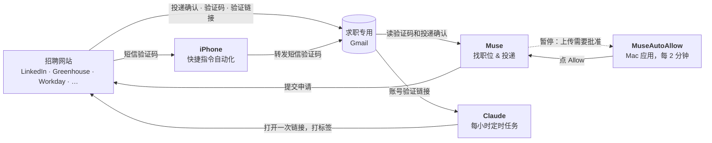

[English](README.md) | **中文**

# Muse 自动投简历

一套放在一台常开 Mac 上、基本不用管的自动求职流水线：
**Muse** 负责投简历，**Claude** 负责点账号验证链接，一个小 **Mac 应用** 负责在 Muse 弹出上传请求时点 Allow。

## 目录
1. [仓库里有什么](#1-仓库里有什么)
2. [各部分怎么配合](#2-各部分怎么配合)
3. [需要准备什么](#3-需要准备什么)
4. [按顺序设置](#4-按顺序设置)
5. [检查是否在正常运行](#5-检查是否在正常运行)
6. [调参](#6-调参)
7. [常见问题](#7-常见问题)
8. [全部停止](#8-全部停止)

---

## 1. 仓库里有什么

| 文件 / 文件夹 | 在哪里运行 | 作用 |
|---|---|---|
| [muse-prompt.md](muse-prompt.md) | **Muse** | 助手的完整操作手册：找新职位、在公司官网投递、从邮箱读验证码、把所有记录写进一个日志和一个表格、定时汇报。 |
| [claude-job-email-verifier.md](claude-job-email-verifier.md) | **Claude**（每小时一次的定时任务） | 在求职专用 Gmail 里找招聘网站发来的 "verify your email / activate your account" 邮件，每个链接只打开一次，并给邮件打标签，保证不会重复打开。 |
| [muse-auto-allow/](muse-auto-allow/) | **你的 Mac** | 可直接编译的后台应用，每 2 分钟在 Muse 的审批列表里点一次 **Allow**。 |
| [mac-auto-approve-script-prompt.md](mac-auto-approve-script-prompt.md) | **AI 编程助手**（比如 Claude Code） | 上面那个文件夹的替代方案：一段 prompt，让 AI 从零帮你生成同样的应用。 |

## 2. 各部分怎么配合



- **Muse** 负责投递。每次上传文件都会停下来等批准，因为 Muse 没有"上传永远允许"的选项。
- **MuseAutoAllow** 自动点 Allow，Muse 就不会卡在等你。
- **Muse** 从邮箱读邮件和短信的**验证码**，自己填进去。
- **验证链接** Muse 点不了（它看到的链接是打码的），所以由 **Claude** 定时任务每小时去打开。这就是 `muse-prompt.md` 第 6.7 节说的 "auto-click option"。

## 3. 需要准备什么

- 一台**一直开着**、插着电的 **Mac**。
- **Muse** 桌面应用。
- **Claude** 桌面应用（用来跑定时任务），以及 Claude 能操作的浏览器（Claude in Chrome 或 Claude 内置浏览器）。
- 一个**只用来求职的 Gmail**，不要用私人邮箱。
- 一部 **iPhone**，如果有网站用短信发验证码（可选，但推荐）。
- 编译 Mac 应用要用的 **Xcode Command Line Tools**：`xcode-select --install`。

## 4. 按顺序设置

### 第 1 步：在 Muse 和 Claude 里都登录求职 Gmail

两个应用要读的是**同一个**求职邮箱：

| 应用 | 怎么做 | 为什么 |
|---|---|---|
| Muse | 让 Muse 连接你的邮箱，它会给你一个连接链接；完成之后确认 Muse 能读到邮件。详见 `muse-prompt.md` 第 6.4 节。 | 读投递确认、拒信、面试邀请和验证码。 |
| Claude | Settings → Connectors → Gmail，连接求职 Gmail。另外在 Claude 要用的浏览器里也登录这个 Gmail。 | 验证任务要搜邮件、打标签。 |

不要在聊天里发密码。网站登录信息通过 Muse 的安全输入表单保存（`muse-prompt.md` 第 6.2 节）。

### 第 2 步：设置 Muse

1. 打开 `muse-prompt.md`，把所有 `[PLACEHOLDER]` 换成你自己的信息（文件开头有对照表）。
2. 把它交给 Muse 作为规则，并按第 1 部分创建投递用的定时任务。
3. 按第 6.9 节的清单走一遍：保存各网站登录、连接邮箱、决定上传请求和验证链接怎么处理。

### 第 3 步：把短信验证码转发到 Gmail（iPhone 快捷指令）

有些网站用短信发验证码。Muse 只能读邮件，所以要把短信转成邮件：

1. iPhone 打开**快捷指令（Shortcuts）** → **自动化（Automation）** → **+** → **信息（Message）**。
2. **信息包含（Message Contains）**：`code`。选**立即运行（Run Immediately）**（"运行时通知"可以关掉）→ **下一步**。
3. 添加操作**发送电子邮件（Send Email）**：
   - 收件人：你的求职 Gmail。
   - 主题：`SMS code`。
   - 正文：点一下，选 **快捷指令输入 → 内容（Shortcut Input → Content）**，也就是短信内容。
   - 展开这个操作，关掉**显示撰写表单（Show Compose Sheet）**，这样会直接发出去，不用你确认。
4. 对网站常用的其他词再各建一个，比如 `verification`、`验证码`。一个关键词一个自动化。
5. 测试：让任意一个网站给你发短信验证码，看邮件有没有到。

iPhone 自带的"邮件"App 里要设置好一个能发信的账户。Muse 会同时在邮箱里找网站原本发的验证码邮件和这封转发邮件（第 6.6 节）。

### 第 4 步：设置 Claude 邮件验证任务（定时任务）

1. 打开 `claude-job-email-verifier.md`，替换 `<YOUR_JOB_APP_GMAIL>` 和 `<YOUR_AGENT_NAME>`（比如填 "Muse"）。
2. 在 Claude 桌面应用里创建一个**定时任务（scheduled task）**：
   - 频率：**每小时**。
   - Prompt：原样粘贴该文件第 2 节里的那段。
   - 打开自动批准，以及"在这台电脑上运行"的选项，这样你不在的时候它也能用你的浏览器。
   - 偷懒的办法：在 Claude 聊天里说 _"create a scheduled task that runs every hour with this prompt"_，然后粘贴那段 prompt。
3. 先手动跑一次，在浏览器弹出权限请求时，允许它访问各个招聘网站的域名。

### 第 5 步：安装 Mac 自动批准应用

**方案 A：直接编译现成的应用（推荐）。**

```
git clone https://github.com/Dark417/muse-auto-job-apply
cd muse-auto-job-apply/muse-auto-allow
./build.sh
```

1. 系统设置 → 隐私与安全性 → **辅助功能（Accessibility）** → **+** → 选择 `muse-auto-allow/MuseAutoAllow.app` → **打开开关**。
2. 打开 Muse，停在审批页（右侧面板的盾牌图标那个 tab），就放在那里别动。
3. 双击 **`muse-on.command`**。它会在后台运行，终端窗口可以直接关掉。双击 `muse-off.command` 可以停止。

完整说明见 [muse-auto-allow/README.md](muse-auto-allow/README.md)（英文）。

**方案 B：让 AI 帮你生成。** 在一个空文件夹里打开 Claude Code（或类似工具），粘贴 `mac-auto-approve-script-prompt.md` 的全部内容。

> MuseAutoAllow 会对 Muse 的**所有**请求点 Allow，包括访问敏感网站的请求。如果只想自动批准上传，看它的 README 怎么改。

### 第 6 步：让 Mac 永远不睡

Mac 睡着或者锁屏了，这个应用就点不了。在系统设置里：

| 设置 | 位置 | 值 |
|---|---|---|
| 不睡眠 | 电池 → 选项（笔记本）或 节能（台式机） | **显示器关闭时防止自动进入睡眠**：打开 |
| 不锁屏 | 锁定屏幕 | **屏幕保护程序启动或显示器关闭后需要密码**：永不 |
| 屏幕保护 | 锁定屏幕 | **不活跃时启动屏幕保护程序**：永不（可选） |

- 一直**插着电**，盖子**打开**（或者合盖但接着外接显示器和电源）。
- 屏幕可以关掉或调暗，只要系统本身醒着就行。
- 这样电脑就一直是解锁状态，只在你放心的地方这么做。
- 重启之后，再双击一次 `muse-on.command`。

## 5. 检查是否在正常运行

| 部分 | 怎么检查 |
|---|---|
| MuseAutoAllow | `pgrep -fl MuseAutoAllow` 显示一行。出现上传请求后，`tail muse-auto-allow/muse-autoallow.log` 里有 `Allow pressed (ok): …`。 |
| Claude 验证任务 | 每小时的结果写着 "No new verification emails." 或者列出验证成功的公司。验证过的邮件在 Gmail 里带 `ats-verified` 标签。 |
| 短信转发 | 短信验证码一分钟内出现在求职 Gmail 里。 |
| Muse | 汇报里有新的投递；审批列表里的上传请求不会越积越多。 |

## 6. 调参

- **找职位的时间窗口（`muse-prompt.md` 第 3.2 节）**：默认只找最近 **12 小时**发布的职位，找不到再放宽到 **24 小时**。如果那天新职位少，或者新职位都已经投过了，Muse 就**找不到新工作，停止投递**。如果汇报里一整天都没有新投递，就把窗口放宽（比如主窗口 24 小时，后备 72 小时），并同步修改第 7.1 节和第 13.1 节里对应的数字。
- **自动批准的频率**：`MuseAutoAllow.swift` 开头的 `interval`（默认 2 分钟）。改完要重新编译，并重新授权辅助功能。
- **验证任务回看多久**：如果 Claude 任务不是每小时跑，就把 prompt 里的 `newer_than:4h` 调大。

## 7. 常见问题

| 现象 | 解决办法 |
|---|---|
| 日志里写 `NOT TRUSTED` | 在辅助功能里删掉 `MuseAutoAllow`，重新添加并打开开关，然后双击 `muse-off.command` 再双击 `muse-on.command`。每次重新编译或移动文件夹之后都要做一次。 |
| 上传请求越积越多 | Mac 是不是睡着或锁屏了？应用还在运行吗（`pgrep`）？Muse 是不是停在审批页？ |
| Muse 说找不到验证码 | 检查短信转发是否正常，以及 Muse 读的是**求职**邮箱，不是私人邮箱。 |
| 验证邮件一直没被打标签 | 页面要求输密码或填表（"needs user"），或者域名不在白名单里。手动处理，或者把域名加进白名单。 |
| 一整天没有新投递 | 找职位的时间窗口太窄，见"调参"。 |

## 8. 全部停止

- **Mac 应用**：双击 `muse-off.command`，或运行 `pkill -f MuseAutoAllow.app`。
- **Claude 验证任务**：在 Claude 里暂停或删除这个定时任务。
- **Muse**：在应用里暂停它的定时任务。
- **短信转发**：在 iPhone 快捷指令里关掉那几个自动化。
